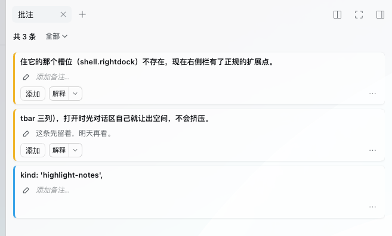
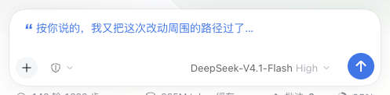

# dsh-plugin-highlight-notes · 批注 ✍️

给 [DeepSeek Harness](https://github.com/deepseek-ai/deepseek-harness) 的回答加批注：**选中文字 → 右键「批注」→ 写备注 → 一键放回输入框**。
批注列表是右侧栏里的一个 tab，和「工作区文件 / 新建终端」并列；交给输入框的原文用的是 DSH 自己的引用节点，和浮动「引用文本」按钮插出来的完全一致。

全部逻辑跑在**浏览器半边**，不碰会话日志、模型请求、文件系统。批注只存在你这台机器的浏览器里。

## 截图





## 环境要求

| 项 | 要求 |
|---|---|
| DeepSeek Harness | **≥ 0.2.2**（用到右侧栏 tab 注册 `sidebarRightTabs`、`inputActions.insertQuote()`、`Menu.anchorPoint`） |
| Node（仅从源码构建时） | `^22.19.0 || >=24.0.0` |

低于 0.2.2 的 DSH 不满足 `engines.dsh`，安装时会被插件管理器拒绝；强行装入也不会挂载（缺少 `sidebarRight` 服务）。

## 功能

| 功能 | 说明 |
|---|---|
| 两种批注 | **仅高亮**：右键一步完成，纯视觉记号，默认不进列表；**可引用**：弹框写备注，进列表并可交回输入框 |
| 列表在右侧栏 | 「批注」是右侧栏的一个 tab，参与框架的列宽计算，打开时**不挤压对话区**（窄窗口下输入框和状态栏不再被挤坏） |
| 原生引用 | 交给输入框的是 shell 自己的引用节点：带引用图标、业务色、可移除按钮，发送时仍是 Markdown 引用块 |
| 列表筛选 | 仅可引用 / 仅高亮 / 全部，默认只看可引用，标签带数量 |
| 高亮 | CSS Custom Highlight API 绘制，不插入任何 DOM 节点，不干扰 Markdown 渲染 |
| 按会话隔离 | 每条批注属于创建它的会话；tab 跟着会话走，切换会话自动换列表、清高亮，切回自动恢复 |
| 跨块选择 | 同一座位内跨段落、标题、列表、行内代码都可以标成**一条**批注（与官方引用一致） |
| 偏移自愈 | 锚点存「座位键 + 偏移 + 引文 + 前后文」，DOM 重建或前文改动后靠引文重新定位 |
| 远处也能定位 | 点列表条目会滚到原文；DSH 只保留会话尾部时，插件按记录的回合**逐页向上加载**直到原文出现（页脚显示进度） |
| 快捷引用 | 右键「批注…」后，备注框里的「添加到对话」把原文和备注直接放进输入框，**不保存批注**、不进列表 |
| 喂给模型 | 引用节点 → 备注行 → 指令行，由你自己按发送。内置「解释 / 不同意」，也可在设置里增删 |
| 可配置 | 「设置 → 批注」里编辑快捷指令的按钮文字与指令语；内置两条以真实行呈现，可改可删，「恢复内置」回到未配置态 |
| 定位不到的提示 | 有批注暂时定位不到时，表头右侧出现一个感叹号图标，悬停/聚焦显示原因；全部正常时完全不占位 |
| 中英文 | 跟随 DSH 语言设置 |

## 安装

```sh
dsh plugin --profile desktop add dsh-plugin-highlight-notes
```

装完**重启** DSH——运行中的进程持有内存里的旧插件树。

桌面应用也可以在「插件」页的安装框里填 `dsh-plugin-highlight-notes`。

### 从源码

```sh
git clone <repo> && cd dsh-plugin-highlight-notes
pnpm install
pnpm build
dsh plugin --profile desktop add "file:$PWD"
```

## 用法

1. 在回答里选中文字（可以跨段落、标题、列表和行内代码），右键 →「批注…」。
2. 写备注（可留空）→「保存批注」。文字被高亮（暖黄），状态栏药丸计数 +1。
   - 只想留个视觉记号：右键直接选「高亮」（冷蓝，不进列表）。
   - 只想把这段放进下一条消息：备注框里点「添加到对话」——写进输入框，但**不保存**。
3. 点药丸打开/切换到右侧栏的「批注」tab：点条目会滚到原文并加深高亮；`[添加]` 只放引用，`[解释 ▾]` 连同指令一起放。
   原文在很远的回合时，页脚会先显示「正在加载更早的内容…」，加载到之后自动居中。
4. 切到别的会话，tab 只显示那个会话自己的批注；切回来原样恢复。

## 数据

- 存在浏览器的 `localStorage`，键为 `dsh-plugin-highlight-notes/v1/<sessionId>`。
- 每条记录带座位键、偏移、引文、前后文，以及创建时所在的聊天回合（用于翻页定位）。
- **不进入会话日志**，换设备或清空站点数据会丢；这是刻意的取舍（见 `DESIGN.md`）。
- 卸载插件不会删除已有数据，重新安装即可看到。

## 已知限制

- **跨座位**的选择不接管（两条回答之间、回答与工具卡片之间）：没有单一锚点，右键会走浏览器原生菜单。
- 折叠起来的内容（思考过程、折叠的工具输出）里的文字暂时标不到；展开后已有的批注会重新定位成功。
- 批注离当前滚动位置很远时，定位要先逐页加载历史，需要几秒；加载过的页面会留在内存里，之后再点是瞬时的。
- 高亮颜色统一；`::highlight()` 只支持静态名，按标签配色留到后续版本。
- 桌面端右键菜单由插件自绘（Electron 原生菜单在宿主进程，插件改不了）。

## 开发

```sh
pnpm typecheck     # tsc
pnpm test          # 锚点定位与读取逻辑的回归用例（纯函数，无浏览器）
pnpm build         # lib/index.js + lib/client.js
pnpm smoke         # 无浏览器加载 bundle，断言槽位与右侧栏 tab 的注册
pnpm verify        # 上面四步一次跑完
pnpm release       # 发版：校验 → 改版本 → 收口 CHANGELOG → 提交 → 打 tag → 推送
```

本地起真实应用（在 deepseek-harness 仓库里）：

```sh
pnpm dsh web --patch ../dsh-plugin-highlight-notes/dev.patch.yml
```

改 client 刷新页面即可；改 host 或 overlay 需要重启。

`demo/` 里是立项前的交互验证页（锚点算法与性能实测），不属于插件运行时。

## 文档

| 文件 | 内容 |
|---|---|
| [`docs/ARCHITECTURE.md`](docs/ARCHITECTURE.md) | 模块地图、槽位与作用域、数据流、锚点算法、存储 schema、构建发布链路 |
| [`DESIGN.md`](DESIGN.md) | 决策记录：为什么这么选，以及还没定的问题 |
| [`docs/screenshots/README.md`](docs/screenshots/README.md) | 截图清单与重新生成方法 |
| [`CHANGELOG.md`](CHANGELOG.md) | 版本历史 |

## 设计决策

见 [DESIGN.md](DESIGN.md)：数据边界、模型可见性、面板形态（右侧栏 tab）、引用模板、会话隔离、跨块选择。
